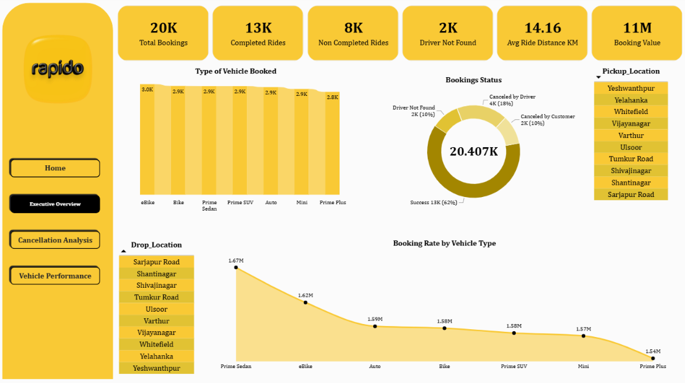
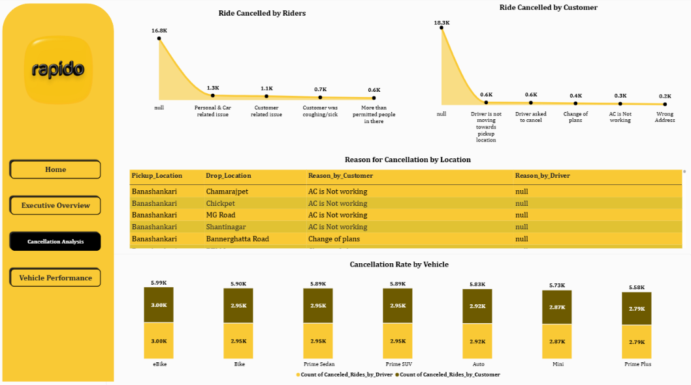
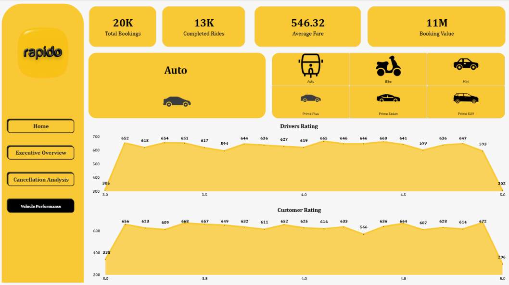

# Rapido Ride Booking Analysis Dashboard | Power BI

## Project Overview

This project is a **Power BI ride-booking analysis dashboard built using a created, synthetic dataset**. The data was created for portfolio and dashboard-practice purposes; it should not be interpreted as official Rapido operational data or verified company figures.

The report presents ride-booking metrics in three analytical sections: Executive Overview, Cancellation Analysis, and Vehicle Performance. The dashboard uses a yellow-and-black visual theme inspired by the Rapido brand.

## Dashboard Preview

![Power BI dashboard preview showing the Executive Overview, Cancellation Analysis, and Vehicle Performance pages] 

### Individual Dashboard Pages

**Executive Overview**

**Cancellation Analysis**

**Vehicle Performance**

## Dashboard Pages and Features

### 1. Executive Overview
- Total Bookings
- Completed Rides
- Non-Completed Rides
- Driver Not Found
- Average Ride Distance
- Booking Value
- Booking status distribution
- Vehicle-category comparison
- Pickup and drop-off location information

### 2. Cancellation Analysis
- Ride cancellations by riders and customers
- Customer and driver cancellation reasons
- Cancellation-related details by location
- Comparison of cancellation counts across vehicle categories

### 3. Vehicle Performance
- Booking and completed-ride KPIs
- Average fare and booking value
- Vehicle categories including Auto, Bike, eBike, Mini, Prime Plus, Prime Sedan, and Prime SUV
- Driver rating distribution
- Customer rating distribution

## Sample Metrics Shown

The dashboard export displays approximately 20K total bookings, 13K completed rides, 8K non-completed rides, 2K driver-not-found cases, an average ride distance of 14.16 km, and booking value displayed as 11M. These are values shown by the created dataset and dashboard, not official Rapido statistics. The PDF does not explicitly identify the currency/unit for booking value or average fare.

## Tools and Skills

- Microsoft Power BI
- KPI cards and chart-based reporting
- Data visualization
- Exploratory analysis
- Dashboard layout and visual design
- Ride-booking and cancellation analysis

## Dataset Note

The dataset used for this project was **created synthetically for learning, analysis, and portfolio demonstration**. It is not claimed to be an authentic dataset supplied by Rapido, and the displayed metrics must not be treated as real-world company performance. The source dataset file is not included in this package.

## Files Included

- `Rapido_Dashboard.pdf` — exported dashboard report
- `images/powerbi-dashboard-preview.png` — combined preview of the three analytical pages
- `images/executive-overview.png` — Executive Overview screenshot
- `images/cancellation-analysis.png` — Cancellation Analysis screenshot
- `images/vehicle-performance.png` — Vehicle Performance screenshot
- `images/cover-preview.png` — cover page screenshot

## How to View

Open `Rapido_Dashboard.pdf` to browse all four pages, or view the dashboard screenshots in the `images` folder. GitHub displays the preview images directly in this README.

## Disclaimer

This is an independent portfolio project created for educational and demonstration purposes. Rapido is referenced only to describe the ride-booking scenario and visual inspiration; this project is not affiliated with or endorsed by Rapido.

Aneesh M A
